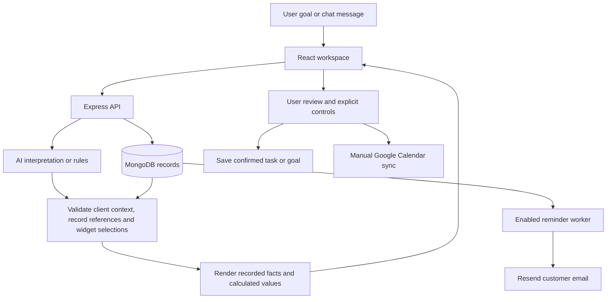

# I2I By AI — Adaptive AI Workspace

**Describe the work. Get the relevant workspace.**

I2I By AI is a HackWave 3.0 prototype for managing client work through an adaptive dashboard and a voice-enabled chatbot. It combines saved task and goal records with client context, usage insights, deadline reminders, and optional Google Calendar integration.

The AI interprets requests and selects approved interface components or existing records. The server supplies displayed task facts and investigation findings from workspace records. It does not autonomously complete business tasks.

## Contents

- [What the project does](#what-the-project-does)
- [Supported scope](#supported-scope)
- [Technology and architecture](#technology-and-architecture)
- [Project structure](#project-structure)
- [Run locally](#run-locally)
- [Private configuration](#private-configuration)
- [Try a demonstration](#try-a-demonstration)
- [API overview](#api-overview)
- [Checks and reliability](#checks-and-reliability)
- [Limitations and next steps](#limitations-and-next-steps)
- [Contributing](#contributing)

## What the project does

### Adaptive dashboard

- Accepts a goal in the sidebar, selects relevant widgets, and changes their order, size, and visibility.
- Supports meeting preparation, usage investigation, overdue work, open issues, meeting follow-ups, and recent messages.
- Gives each demo client six quick actions with business-specific labels.
- Supports refinements such as **Also show overdue tasks** and **Remove next actions**.
- Offers previews before applying a change, pinned widgets, an attention budget, undo, and earlier-layout restoration.
- Uses a shared design system with light/dark themes and responsive layouts. **Why this?** shows rationale, recorded evidence, and source freshness.

### I2I Chat and voice

- Opens from a small button at the bottom-right; the panel starts hidden and can be closed with its button or Escape.
- Supports typed messages, microphone input where the browser supports speech recognition, and spoken replies in English or Hindi/Hinglish.
- Saves conversations and unfinished task drafts separately for each selected client. Users can reopen a chat and continue earlier discussions.
- Answers task status, owner, priority, due-date, blocker, and goal-progress questions from saved records. Missing information is reported as **Not recorded**.
- Interprets explicit dashboard commands such as **Show open issues**, **Show usage**, and **Open calendar**. Requests about another client ask the user to switch the Client selector.
- Starts guided task setup when asked to add work. It asks up to two optional context questions when useful, collects required details, and requires review and confirmation before saving.

The AI may interpret the phrasing of a question, but it cannot supply the displayed task facts as unchecked free-form claims. Record references must belong to the selected snapshot. Suggestions are distinguished from completed actions.

### Tasks, goals, and Gap Radar

- The **Add task** card saves title, owner, due date, priority, status, and optional details, blocker reason, and location.
- The searchable task list includes upcoming, in-progress, blocked, and completed work.
- Goals link existing tasks; completion percentages are calculated from linked task records.
- **Live Goal Graph & Gap Radar** highlights overdue, blocked, missing, and stale work. A manually completed goal does not automatically complete its tasks.

### Notifications and email reminders

- In-app alerts cover deadlines three days and one day in advance, due-today and overdue work, blockers, and goal risks. Dates use India time.
- Optional desktop alerts require browser permission and an open application.
- Customer reminders use **Resend email only**. WhatsApp and SMS delivery are not supported.
- The backend worker checks reminders every minute. Email delivery requires credentials, a valid sender, saved customer settings, and an enabled delivery switch.
- Reminder attempts are recorded to avoid duplicate sends. Provider acceptance is not confirmation that an email reached the inbox.

See [notification setup and delivery behavior](intent-workspace/NOTIFICATIONS.md).

### Calendar, Google Meet, and places

- **Calendar, meetings & places** starts compact. Clicking its heading or opening it through chat expands it.
- Shows the selected client's task deadlines and manually recorded meetings, urgent work, reminders, and completion dates.
- Uses `Asia/Kolkata`. Date-only entries are all-day; timed entries can include an end time.
- Optionally connects a Google account to a separate **I2I By AI** calendar. Sync is explicit, manual, and one-way.
- A timed meeting can request a Google Meet link during sync. The Join button appears only after Google returns a valid link.
- Addresses open Google Maps searches. These are search links, not embedded maps or verified coordinates.

Saving a calendar entry does not sync it automatically. A completion entry records a date without changing the linked task's status. Chat cannot sync events, create Meet links, or send invitations itself.

See [Calendar, Meet, and location setup](intent-workspace/CALENDAR.md).

## Supported scope

The project implements the following intent-to-interface flow within its existing data tools and widget catalog:

| Requirement | Implementation |
|---|---|
| Understand intent and clarify ambiguity | Natural-language planning, rules fallback, clarification choices, and guided task questions |
| Select relevant information and tools | Allowlisted investigation tools over client, usage, issue, and project records |
| Dynamically arrange UI components | Validated widget selection, ordering, sizing, replacement, and refinement |
| Generate task-specific interfaces with consistent design | Combinations of existing React widgets using shared styling |
| Adapt when the goal changes | New goals, chat display commands, refinements, previews, undo, and restoration |
| Explain surfaced information and actions | Widget rationale, recorded evidence, freshness, and investigation traces |

The app assembles approved widgets; it does not generate arbitrary application code. It helps people track and prepare work, including drafts. It does not transfer money, book travel, fix code, deploy software, or perform whatever a task title describes. Unsupported requests are redirected to supported workspace work or a task for a person to complete.

Client overview, messages, issues, meeting notes, and usage belong to the selected client. The existing overdue-project view, blockers, owner workload, and overall task list cover the workspace. Client grouping is not authentication or a production security boundary.

## Technology and architecture

| Area | Implementation |
|---|---|
| Frontend | React 18, Vite 5, JavaScript, CSS, native browser controls |
| Backend | Node.js, Express |
| Persistence | MongoDB; MongoDB driver and Mongoose |
| AI | NVIDIA-hosted OpenAI-compatible chat completions, with configurable base URL and model |
| Rules and validation | JavaScript intent rules, allowlisted widgets/tools, structured record selection |
| Voice | Browser speech recognition and speech synthesis |
| Customer email | Resend |
| Calendar | Google OAuth, Calendar API, optional Meet conference creation |
| Checks | Native Node.js tests, mocked provider responses, frontend builds, browser verification |



AI investigation runs against the selected client's context. Planner results are not cached; each request performs a fresh investigation. The frontend refreshes records when applying a layout and prevents superseded requests from replacing a newer screen. Restoring a layout uses current records rather than replaying old AI findings.

## Project structure

```text
.
├── README.md
├── AGENTS.md
└── intent-workspace/
    ├── client/
    │   ├── package.json
    │   ├── vite.config.js
    │   └── src/
    │       ├── App.jsx                  # Adaptive workspace and chat/dashboard bridge
    │       ├── registry.jsx             # Shared widget renderers
    │       ├── VoiceAssistant.jsx       # Floating chat, voice and saved conversations
    │       ├── CalendarWorkspace.jsx    # Calendar and places
    │       ├── NotificationCenter.jsx   # In-app and desktop alerts
    │       ├── AddTask.jsx / TaskList.jsx
    │       └── GoalWorkspace.jsx
    ├── server/
    │   ├── package.json
    │   ├── server.js                    # API server and reminder worker
    │   ├── intentRoutes.js / llm.js      # Validated layout planning
    │   ├── chatRoutes.js
    │   ├── verifiedAnswers.js           # Record-based chat answers
    │   ├── conversationStore.js         # Client-specific history and drafts
    │   ├── calendarRoutes.js / calendar.js
    │   ├── agent/                       # Investigation tools and AI helper
    │   └── data/                        # MongoDB payloads and fictional demo seed
    ├── CALENDAR.md
    ├── NOTIFICATIONS.md
    └── RELIABILITY.md
```

## Run locally

### Requirements

- Node.js with npm. The project has been checked with Node.js 24.
- MongoDB running locally or a reachable MongoDB database.
- Git for cloning the repository.
- Optional AI, Resend, and Google credentials for their respective features.

MongoDB is required for the current workspace records, saved chats, tasks, goals, and integrations. An older seed-file fallback remains in some legacy code; it is not a replacement for the database in the current application.

### 1. Clone and install

```powershell
git clone https://github.com/KkDhote/i2i-ai-HackWave-3.git
cd i2i-ai-HackWave-3
cd intent-workspace/server
npm install
```

Create `intent-workspace/server/.env` using the configuration below. Keep it private.

### 2. Initialize a fresh demo database

From `intent-workspace/server`, only for an empty or disposable demo database:

```powershell
node data/seedReal.js
```

**This command deletes and replaces the `iw_*` collections listed in `server/data/service.js`, including client and task data. Do not run it over work you want to keep. Replacing tasks can also affect existing goal links.** Skip this step when the database already contains your workspace.

Use this command rather than `npm run seed:real`: that npm script is not currently defined. The existing `npm run seed` populates an older dataset format.

### 3. Start the backend

In the server terminal:

```powershell
npm run dev
```

The default backend address is `http://localhost:5001`. `npm start` runs the backend without watch mode.

### 4. Start the frontend

Open a second terminal at the repository root:

```powershell
cd intent-workspace/client
npm install
npm run dev -- --host 127.0.0.1 --port 5173 --strictPort
```

Open [I2I By AI locally](http://127.0.0.1:5173/). Vite forwards `/api` requests to `http://localhost:5001`.

There is no `package.json` at the repository root or directly inside `intent-workspace`. Run npm commands inside the **server** or **client** folder. If port 5001 is already occupied, check the existing backend process before starting another copy.

The commands above start development servers. A frontend production build does not set up backend hosting or production authentication.

## Private configuration

### Required local database settings

Save in `intent-workspace/server/.env`:

```dotenv
PORT=5001
MONGO_URI=mongodb://127.0.0.1:27017/intent_workspace
```

The variable is `MONGO_URI`, not `MONGODB_URI`. If you change the backend port, update the Vite proxy in `client/vite.config.js` too.

### Optional AI

```dotenv
NVIDIA_API_KEY=
NVIDIA_BASE_URL=https://integrate.api.nvidia.com/v1
LLM_MODEL=meta/llama-3.3-70b-instruct
```

Set your own key privately. The current planner, task intake, and chat interpreter use the NVIDIA-compatible helper. `ANTHROPIC_API_KEY` is not the setting for these current flows. Without AI, supported quick actions, rules, record-based answers, and required task setup remain available; interpretation of unfamiliar phrasing is more limited.

### Optional customer email

```dotenv
NOTIFICATION_DELIVERY_ENABLED=false
RESEND_API_KEY=
NOTIFICATION_EMAIL_FROM=
```

Configure a valid Resend sender and customer settings first. Set delivery to `true` and restart the backend when ready to enable sending. Keep MongoDB and the backend running. See [NOTIFICATIONS.md](intent-workspace/NOTIFICATIONS.md) for deduplication, failure, and missed-reminder behavior.

### Optional Google Calendar and Meet

```dotenv
GOOGLE_CLIENT_ID=
GOOGLE_CLIENT_SECRET=
GOOGLE_CALENDAR_REDIRECT_URI=http://127.0.0.1:5173/api/calendar/oauth/callback
GOOGLE_CALENDAR_APP_URL=http://127.0.0.1:5173/
GOOGLE_CALENDAR_TOKEN_KEY=
```

Enable Calendar API in the same Google Cloud project that created the OAuth client. Configure consent/test users and register the exact callback URL above as an authorized redirect URI. Generate and retain the encryption key using [CALENDAR.md](intent-workspace/CALENDAR.md); changing it makes previously encrypted tokens unreadable until reconnection.

The app and callback must use the same hostname. These integration routes are restricted to configured local loopback origins. One Google connection is shared by this local workspace.

Never put real keys, passwords, tokens, or private `.env` settings in frontend code, screenshots, or commits. Restart the backend after changing environment settings.

## Try a demonstration

The seeded companies and contacts are fictional Indian demo data: **Bharat Logistics, Annapurna Foods, Aarogya Healthcare, Utsav Retail, Pragati Tech Labs, Narmada Finance, Surya Energy, and Vidya Education**. Demo revenue is displayed in rupees/lakh.

1. Select **Utsav Retail** and click **Prepare Diwali readiness meeting**. Inspect issues, messages, meeting notes, and talking points.
2. Click **Why this?** to inspect the data behind a widget and any stale-source warning.
3. Open the bottom-right chat button. Type **Show open issues**, then **Also show overdue tasks**. The dashboard changes; the overdue view covers workspace-wide project work.
4. Ask **Priority tasks** or use a saved task's full title to ask for its status or blocker. Only tasks recorded for the selected client belong to that chat's snapshot.
5. Say **Add a task: Fix login issue**. Supply the missing owner/date, review the draft, and confirm only if you want it saved. Cancel leaves the task unsaved.
6. Say **Open calendar**. Add a dated entry and location. If Google is configured and connected, use the entry's explicit sync control; request Meet only for a timed meeting.
7. Inspect Notifications. Customer email delivery requires its separate setup and enabled switch.

Browser microphone and desktop-notification permissions are optional. Voice input may use the browser's online recognition service.

## API overview

Frontend requests use `/api`; the Vite development proxy sends them to the backend.

| Endpoint | Purpose |
|---|---|
| `GET /api/health` | Backend availability and whether an AI key is configured; not a provider connectivity test |
| `GET /api/data?client=harborline` | Dashboard data for a selected client, including workspace-wide project metrics |
| `POST /api/intent` | Plan or refine the dashboard using `text` or a supported `pick`, `clientId`, and optional current screen |
| `POST /api/chat` | Interpret a client conversation and return a record-based answer |
| `POST /api/tasks/intake` | Understand a task brief and request useful missing context |
| `GET /api/goals/tasks` / `POST /api/goals/tasks` | List workspace tasks or save a validated task |
| `GET /api/goals` / `POST /api/goals` / `PATCH /api/goals/:id` | Read, create, or update goal records |
| `GET/POST /api/conversations` | List client chats or create a conversation |
| `GET/PUT /api/conversations/:id` | Read a client conversation or append messages/update its draft |
| `GET /api/notifications` | Calculated in-app alerts |
| `GET /api/notifications/settings` / `PUT /api/notifications/settings/:taskKey` | Customer email reminder settings |
| `GET /api/calendar/status` / `GET /api/calendar/entries` | Connection state and selected-client agenda |
| `POST /api/calendar/entries` | Save a local dated entry |
| `POST /api/calendar/connect` / `GET /api/calendar/oauth/callback` | Begin and finish Google authorization |
| `POST /api/calendar/sync` / `POST /api/calendar/disconnect` | Explicit event sync or remove local connection tokens |
| `POST /api/action` | Prepare an editable draft from recorded evidence |
| `GET /api/eval` | Bundled rules evaluation; explicit AI evaluation can call the configured provider |

Example deterministic layout request:

```json
{
  "pick": "issues",
  "clientId": "harborline"
}
```

Example natural-language request:

```json
{
  "text": "Prepare the Utsav meeting",
  "clientId": "harborline"
}
```

A successful response includes `status: "plan"`, the resolved `clientId`, intent metadata, and an approved component list. Unclear or unsupported requests return clarification/unsupported responses. Invalid request structures are rejected. Do not treat browser client selection as authorization for a public deployment.

## Checks and reliability

From `intent-workspace/server`:

```powershell
node --test --test-concurrency=1 intentRoutes.test.js chatRoutes.test.js conversationRoutes.test.js taskIntake.test.js plannerReliability.test.js verifiedAnswers.test.js tasks.test.js taskVisibility.test.js data/indianDemo.test.js calendar.test.js
```

From `intent-workspace/client`:

```powershell
node --test src/clientQuickActions.test.js src/workspaceRequest.test.js src/taskAnswers.test.js src/taskDialog.test.js src/taskCreation.test.js
npm run build
```

The reliability update passed **59 automated tests** across those commands, plus browser checks for chat/dashboard changes, client switching, missing reasons, task confirmation, previews, and layout restoration. Tests use synthetic records and mocked AI/provider responses.

All **30 bundled rule examples** match their expected outcomes. This is a finite sample, not proof of 100% accuracy on unseen requests, live-provider behavior, or incorrect stored records. Interpretation confidence is an estimate, not a measured accuracy score.

Read [RELIABILITY.md](intent-workspace/RELIABILITY.md) for the boundaries and evaluation approach.

## Limitations and next steps

- This is a shared local prototype without production login, role-based access, or authenticated tenant isolation. Client-scoped chats do not provide a security boundary by themselves.
- The adaptive interface uses an existing widget catalog. The task list, calendar, goal section, and Add task remain separate mounted sections.
- AI can misinterpret unfamiliar language. Clarifications and validated outputs reduce errors; they do not prove correct interpretation for every possible input.
- Answers reflect the records, including missing, incomplete, stale, or fictional demo data. Cause hypotheses are not confirmed causes. Partial snapshots do not establish full-project totals.
- Browser voice support varies. Desktop alerts require an open page; email reminders require the backend/worker and configured sending.
- Google integration uses one shared local connection, manual one-way sync, and no attendee invitations. Maps links do not verify addresses.
- Action buttons prepare drafts. Opening an email app does not send a message or execute the named business work.
- `npm run build` creates the frontend bundle; production backend hosting, monitoring, and secure deployment still need a separate plan.

The next priorities are production authentication and authorization, broader reviewed tests using actual client phrasing, explicit multi-user integration ownership, and deployment/monitoring. New business integrations should be added only with clear data and execution boundaries.

## Contributing

1. Fork the repository and create a branch.
2. Keep changes within the documented scope and add meaningful checks where behavior changes.
3. Run the relevant tests and frontend build.
4. Keep credentials, private environment files, dependencies, backups, and generated output out of commits.
5. Open a pull request describing the behavior, validation, and limitations.

**Project:** I2I By AI · **Event:** HackWave 3.0

**Repository:** [KkDhote/i2i-ai-HackWave-3](https://github.com/KkDhote/i2i-ai-HackWave-3)
