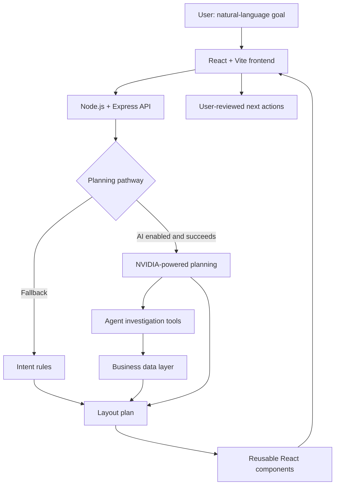

# I2I By AI

### An AI-powered workspace that adapts to what you want to accomplish

**Intent-to-Interface** is a prototype of an adaptive business workspace. Instead of forcing users to navigate a fixed dashboard, it interprets a natural-language goal, selects relevant business information, and assembles task-focused interface components.

> **Project status:** Working React dashboard and rule-driven dynamic layouts; AI-agent integration and several interactive actions are being verified. This repository is a hackathon prototype, not a production-ready system.

## The problem

Business users often switch between CRM records, usage analytics, project boards, and messages to complete a single task. Fixed dashboards display the same information regardless of whether someone is preparing for a meeting, investigating declining engagement, or resolving overdue work.

## Our solution

Users describe their goal in plain language, such as:

- **“Prepare for tomorrow's client meeting”** → client summary, issues, recent communication, meeting notes, talking points, and next actions.
- **“Investigate why active users dropped”** → usage metrics, trend chart, release history, affected segments, and possible causes.
- **“Review overdue project work”** → overdue tasks, owners, priorities, blockers, and recommended follow-ups.

The workspace then chooses and rearranges relevant UI widgets. The current implementation supports rule-based planning as a fallback when AI planning is unavailable.

## Key capabilities

| Capability | Status |
| --- | --- |
| React dashboard and reusable widgets | Demonstrated |
| Intent-driven layout switching | Demonstrated (rules path) |
| Client selection and client-specific business data | Demonstrated |
| Saved chats and resumable task drafts for each client | Implemented; history, client scoping and revisions checked with fake records |
| Task-specific questions with typed and voice input | Implemented; clear tasks skip extra context questions and saving requires review/confirmation |
| Overview, usage, meeting, and overdue-work layouts | Demonstrated |
| MongoDB integration with seed-data fallback | Implemented; runtime environment may vary |
| AI planning using NVIDIA API | Integrated in current backend; end-to-end validation pending |
| Agent tools and evidence trace | Files installed; UI/runtime validation pending |
| “Needs your attention” briefing | UI installed; verify live rendering |
| Contextual **Next actions** buttons | **Known issue:** buttons may render empty |
| Evaluation: rules vs AI | Needs a recorded test run |

**Note:** A high confidence score or a dynamically changing layout is not, by itself, proof that an LLM was used. Check the backend response source and agent trace during demonstrations.

## Client chat and task setup

Select a client in the sidebar, then use **I2I Chat**. Its **Saved chats** menu reopens that client's conversations, including unfinished task drafts. **New chat** keeps the previous conversation available. Messages and drafts are stored in MongoDB; failures are shown with a retry option. This groups conversations in the shared demo workspace; separate authenticated customer accounts are not implemented.

Describe the task naturally, for example `Add a task: Fix login issue; owner Ravi; due tomorrow`. The chatbot asks relevant optional questions, such as the failing app/error, instead of a fixed checklist. Clear tasks skip these questions, and **Skip extra questions** is available. Priority defaults to Medium and status to open. Missing owner, due date and a reason for blocked work are still required. Review the details and confirm before the task appears in the task list. The task saves the supplied brief and context answers for future questions.

To reuse earlier details, reopen the conversation and say `Add a task based on our earlier discussion`. AI intake can use that conversation's context when the existing NVIDIA provider is configured. If AI is unavailable, rules ask for missing details instead of guessing. All messages are retained up to the database document size limit; long chats show recent messages, let users load older pages, and search earlier discussion for relevant model context. The model may ask for clarification when that bounded context is insufficient. These changes were checked with mocked model responses, without sending real client conversations to a provider.

## Architecture



Agent investigation and action execution remain under validation. The diagram shows the intended integrated flow, not proof that every branch is passing end-to-end tests.

## Tech stack

| Layer | Technology |
| --- | --- |
| Frontend | React, Vite, CSS |
| Backend | Node.js, Express |
| Data | MongoDB / seed-data fallback |
| AI | NVIDIA API integration, with rule-based fallback |
| Agent | JavaScript-based investigation, model access, and read-only tools |

## Repository structure

```text
intent-workspace/
├── client/
│   ├── src/
│   │   ├── App.jsx             # App shell and workspace state
│   │   ├── registry.jsx        # Reusable widget registry
│   │   ├── api.js              # Backend requests
│   │   ├── Briefing.jsx        # Attention/briefing panel
│   │   ├── AgentPanel.jsx      # Agent decision/evidence UI
│   │   └── agent.css
│   └── package.json
├── server/
│   ├── agent/
│   │   ├── investigate.js      # Investigation orchestration
│   │   ├── nvidia.js           # NVIDIA model integration
│   │   └── tools.js            # Data-reading tools
│   ├── data/                  # Data routes, payloads, seed scripts
│   ├── actions.js             # Contextual action handling
│   ├── catalog.js             # Available layouts
│   ├── eval.js                # Evaluation logic
│   ├── intent.js              # Rule-based intent matching
│   ├── llm.js                 # AI planner
│   ├── plan.js                # Plan construction and updates
│   ├── server.js              # Express server and API
│   ├── store.js               # Workspace data access
│   └── package.json
└── README.md
```

Some files were introduced through incremental development packs. Your final repository may differ slightly; update the tree to match the files you commit.

## Getting started

### Requirements

- Node.js and npm (use a current LTS release)
- Optional: locally running MongoDB
- Optional: NVIDIA API credentials for AI-backed behavior

### 1. Install dependencies

From the repository root:

```bash
cd client
npm install

cd ../server
npm install
```

### 2. Configure the backend

Create `server/.env` (do **not** commit this file):

```dotenv
PORT=5001
MONGO_URI=mongodb://127.0.0.1:27017/intent_workspace
NVIDIA_API_KEY=your_key_here
```

`NVIDIA_API_KEY` is optional for rule-based demonstrations. The current server checks this variable before calling the AI planner. Without it, or if the model call fails, rule-based responses may appear.

The project has changed providers during development; use the variable expected by your **current** `server.js`, not an older guide referring to `ANTHROPIC_API_KEY`.

### 3. Start the backend

```bash
cd server
npm run dev
```

Expected local backend address: `http://localhost:5001`.

### 4. Start the frontend

In a second terminal:

```bash
cd client
npm run dev
```

Open the Vite URL shown in the terminal (usually `http://localhost:5173`). The frontend must be configured to proxy `/api` requests to port 5001, or otherwise use the appropriate backend origin.

### 5. Verify API responses

```bash
curl http://localhost:5001/api/health
curl 'http://localhost:5001/api/data?client=kestrel'
```

The health endpoint should report `ok: true`. The model availability field depends on the server revision and environment. A configured API key does not guarantee a successful model request—confirm by running a test prompt and inspecting the returned source/agent trace.

If your repository includes the data-pack seeding script and you want fresh demo records:

```bash
cd server
node data/seedReal.js
```

Only run this against a **development/demo database**; review the seeding script first, as it may write data.

## API overview

| Method | Path | Purpose |
| --- | --- | --- |
| `GET` | `/api/health` | Basic backend/model configuration check |
| `GET` | `/api/data?client=kestrel` | Retrieve client-scoped data |
| `POST` | `/api/intent` | Interpret goal and return a layout plan |
| `POST` | `/api/action` | Handle a contextual action request |

Other endpoints such as briefing or evaluation depend on the installed update packs; verify current routes in `server.js` and `server/data/routes.js` before documenting them as stable.

Example intent request:

```bash
curl -X POST http://localhost:5001/api/intent \
  -H 'Content-Type: application/json' \
  -d '{"text":"Investigate why active users dropped","clientId":"kestrel"}'
```

## Demo walkthrough

1. Start on **Workspace overview** and explain the attention cards and overall metrics.
2. Select a client and enter **“Prepare for tomorrow's client meeting.”** Show the meeting-focused widgets.
3. Enter **“Investigate why active users dropped.”** Show the trend, affected segments, and supporting context.
4. Enter **“Review overdue project work.”** Show owners, delays, and blockers.
5. If the AI path is verified, expand **How the agent decided** to show real tool calls and evidence.
6. Test a contextual next action and demonstrate human approval before any external effect.
7. Compare rule-based and AI evaluation outputs using actual recorded results.

## Current limitations and roadmap

- [ ] Fix the empty **Next actions** card; verify buttons and action preview/approval.
- [ ] Confirm the agent's trace survives API response handling and reaches `AgentPanel`.
- [ ] Verify NVIDIA model requests actually succeed; clearly distinguish AI plans from rules fallback.
- [ ] Validate attention briefing against live API responses.
- [ ] Test **Pin**, **Undo/Restore**, **attention budget**, and **demo/privacy mode** end-to-end.
- [ ] Run a repeatable rules-vs-AI evaluation and report measured accuracy and latency.
- [ ] Add loading, empty, timeout, and error states.
- [ ] Add tests, authorization, logging redaction, and deployment configuration.
- [ ] Record a backup demo and finalize the hackathon pitch.

## Evaluation approach

Use the same set of prompts and client records for both methods. Track intent classification, selected-widget relevance, task completion, latency, tool correctness, and whether claims are grounded in retrieved evidence. Publish only observed numbers; do not present seeded data or illustrative results as live business performance.

## Security and data considerations

- Never commit `.env`, API keys, customer credentials, or private records.
- Use synthetic or permissioned demo data during judging.
- Redact secrets from logs and screenshots.
- Require explicit approval for sending emails or making external changes.
- Add authentication and per-client authorization before production deployment.

## Why this project matters

**Intent-to-Interface shifts the workflow from “find the right screen” to “describe the task.”** Its value is not simply a generated dashboard: the longer-term goal is a transparent, data-grounded workspace that helps users move from intent to informed action.

---

**Built for a hackathon • Prototype under active development**
